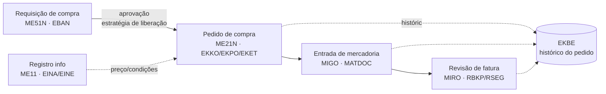
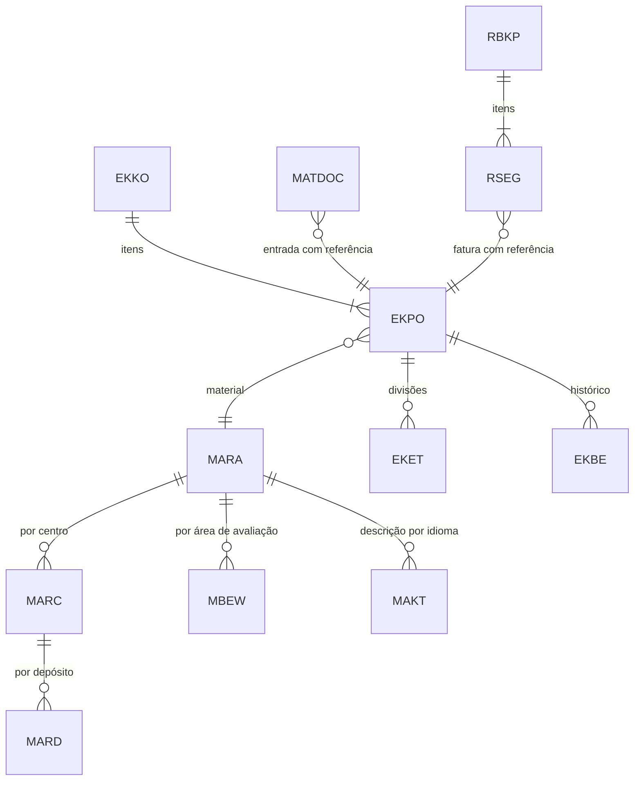

# SAP MM - Study

> Nível: prática
> Materials Management: dado mestre de material, compras, estoque e revisão de fatura. Relacionados:
> [SAP-Procure-to-Pay-erp-study](https://github.com/igor-barral/SAP-Procure-to-Pay-erp-study),
> [SAP-FI-erp-study](https://github.com/igor-barral/SAP-FI-erp-study),
> [SAP-SD-erp-study](https://github.com/igor-barral/SAP-SD-erp-study),
> [SAP-Enterprise-Structure-erp-study](https://github.com/igor-barral/SAP-Enterprise-Structure-erp-study),
> [SAP-Business-Partner-erp-study](https://github.com/igor-barral/SAP-Business-Partner-erp-study),
> [SAP-WM-erp-study](https://github.com/igor-barral/SAP-WM-erp-study), [SAP-EWM-erp-study](https://github.com/igor-barral/SAP-EWM-erp-study).

## Objetivo

O MM é o módulo que responde "o que a empresa compra, onde guarda, quanto tem e quanto vale". Quase todo
desenvolvimento ABAP em logística lê as tabelas do MM: um relatório de estoque, uma interface de pedido de
compra com o fornecedor, uma validação na entrada de mercadoria. Entender o modelo de dados e o fluxo de
documentos do MM é o que permite ler uma especificação funcional sem precisar perguntar o básico ao consultor.

Ao concluir este estudo você deverá ser capaz de responder perguntas como:

- Quais visões do material cada área mantém?
- Onde fica o estoque de um material por centro e depósito?
- Qual a diferença entre o documento de material e o documento contábil gerados na entrada de mercadoria?
- O que é um tipo de movimento e por que ele é central no MM?
- O que mudou no MM do ECC para o S/4HANA para quem escreve `SELECT`?
- Qual a relação entre pedido de compra, histórico do pedido e revisão de fatura?

## Ponte

| O que eu já conheço | Equivalente no SAP MM |
|---|---|
| Tabela `produtos` com colunas de todas as áreas | Material master dividido em tabelas por nível organizacional (`MARA`, `MARC`, `MARD`, `MBEW`...) |
| Tabela `estoque` com saldo por filial/almoxarifado | Estoque por centro e depósito, derivado dos documentos de material |
| Tabela `movimentacoes_estoque` com tipo "entrada"/"saída" | Documento de material com **tipo de movimento** (101, 201, 261, 311, 601...) |
| Pedido de compra no ERP próprio (cabeçalho + itens) | `EKKO` (cabeçalho) + `EKPO` (item) + `EKET` (divisões de remessa) |
| Conferência de nota fiscal de entrada contra pedido | Revisão de fatura logística (MIRO) com *three-way match* |
| Trigger que gera lançamento contábil ao dar entrada | Determinação automática de contas (transação OBYC), sem código custom |
| Cadastro de fornecedor separado de cliente | Business Partner com papel de fornecedor (no S/4HANA) |

A diferença conceitual mais importante: num ERP próprio o saldo de estoque costuma ser uma coluna atualizada
por *trigger* ou serviço. No SAP, o saldo é consequência dos documentos de material; o documento é imutável e
um erro é corrigido com um movimento de estorno, não com `UPDATE`.

## Conteúdo

### 1. Material master

O material master é um único cadastro dividido em **visões** (*views*), e cada visão é mantida por uma área e
gravada no nível organizacional ao qual pertence.

| Visão | Quem mantém | Nível organizacional | Tabela principal |
|---|---|---|---|
| Dados básicos | Engenharia, cadastro | Mandante (vale para toda a empresa) | `MARA` (descrições em `MAKT`) |
| Compras | Compras | Centro | `MARC` |
| MRP (planejamento) | Planejamento | Centro | `MARC` |
| Dados de depósito / armazenagem | Logística | Centro / depósito | `MARC` / `MARD` |
| Contabilidade | Custos / contabilidade | Área de avaliação (normalmente o centro) | `MBEW` |
| Vendas | Comercial | Organização de vendas + canal de distribuição | `MVKE` |
| Unidades de medida alternativas | Cadastro | Mandante | `MARM` |

Transações: `MM01` (criar), `MM02` (modificar), `MM03` (exibir). No S/4HANA, existem apps Fiori equivalentes;
procure por "Manage Product Master Data" na SAP Fiori apps reference library.

Conceitos que aparecem em especificação:

- **Tipo de material** (`MARA-MTART`): controla quais visões existem e se o material é avaliado. Exemplos
  do padrão: `ROH` (matéria-prima), `HALB` (semiacabado), `FERT` (produto acabado), `HAWA` (mercadoria para
  revenda).
- **Controle de preço** (`MBEW-VPRSV`): `S` (preço padrão) ou `V` (preço médio móvel). Define como o estoque
  é valorizado e se diferenças de preço vão para uma conta de diferença.
- **Grupo de mercadorias** (`MARA-MATKL`): classificação usada em compras e relatórios.

### 2. Estoque por centro e depósito

- **Centro** (`WERKS`): fábrica, filial, centro de distribuição.
- **Depósito** (`LGORT`): subdivisão física ou lógica do estoque dentro do centro.
- O saldo por depósito (estoque de utilização livre, em controle de qualidade, bloqueado) aparece em `MARD`.
  Estoque especial (consignação, de cliente, de projeto) fica em outras tabelas; confirme no sistema qual
  delas o seu cenário usa.
- Transações de consulta: `MMBE` (visão geral de estoque), `MB52` (estoque por depósito), `MB51` (lista de
  documentos de material).

No S/4HANA, os documentos de material passaram a ser gravados na tabela **`MATDOC`**. As tabelas de saldo do
ECC continuam acessíveis por `SELECT`, mas os campos de quantidade são calculados a partir do `MATDOC` por
views de compatibilidade. Isso explica por que código antigo que lê `MARD` ou `MSEG` continua compilando e
funcionando, e por que ele pode ficar mais lento em volume (detalhes em
[SAP-S4HANA-erp-study](https://github.com/igor-barral/SAP-S4HANA-erp-study)).

### 3. Tipos de movimento

Todo movimento de estoque tem um **tipo de movimento** (`BWART`). Ele define o sentido da quantidade, o tipo de
estoque afetado e a chave de lançamento contábil usada na determinação de contas.

| Tipo | Significado (padrão) | Uso típico |
|---|---|---|
| `101` | Entrada de mercadoria para pedido de compra | Recebimento do fornecedor |
| `102` | Estorno da entrada 101 | Correção de recebimento |
| `122` | Devolução ao fornecedor | Material com defeito |
| `201` | Saída para centro de custo | Consumo interno |
| `261` | Saída para ordem (produção ou manutenção) | Consumo em ordem |
| `311` | Transferência entre depósitos (mesmo centro) | Movimentação interna |
| `601` | Saída de mercadoria para remessa | *Post goods issue* do SD |

Os tipos de movimento são configuráveis; o cliente pode ter tipos próprios na faixa reservada ao cliente.
Sempre confirme no sistema o que cada tipo faz naquele projeto.

### 4. Compras: requisição e pedido

| Objeto | Transação (SAP GUI) | Tabelas | Observação |
|---|---|---|---|
| Requisição de compra | `ME51N` / `ME52N` / `ME53N` | `EBAN` | Pode nascer do MRP ou manualmente |
| Liberação de requisição | `ME54N`, `ME55` | `EBAN` | Estratégia de liberação configurada pelo funcional |
| Solicitação de cotação | `ME41` | `EKKO`/`EKPO` | Mesmas tabelas do pedido, outra categoria de documento |
| Contrato / programa de remessas | `ME31K` / `ME31L` | `EKKO`/`EKPO` | Contratos de longo prazo |
| Pedido de compra | `ME21N` / `ME22N` / `ME23N` | `EKKO`, `EKPO`, `EKET` | `EKET` = divisões (datas e quantidades de entrega) |
| Registro info (fornecedor x material) | `ME11` / `ME12` / `ME13` | `EINA`, `EINE` | Preço e condições padrão |
| Lista de fontes | `ME01` | `EORD` | Fornecedores permitidos por material/centro |
| Histórico do pedido | aba no `ME23N` | `EKBE` | Entradas e faturas vinculadas a cada item |

O campo `EKKO-BSTYP` (categoria do documento de compra) diferencia pedido, cotação, contrato e programa de
remessas na mesma tabela. `EKKO-BSART` é o tipo de documento (ex.: `NB` para pedido padrão), configurável.

### 5. Entrada de mercadoria (MIGO)

A `MIGO` é a transação única para movimentos de mercadoria. Numa entrada com referência a pedido (tipo 101):

1. O sistema propõe itens e quantidades a partir do pedido.
2. Grava um **documento de material** (número + ano), no S/4HANA em `MATDOC`; no ECC em `MKPF`
   (cabeçalho) e `MSEG` (itens).
3. Se o material é avaliado, grava também um **documento contábil** (`BKPF`/`BSEG` e, no S/4HANA, `ACDOCA`).
4. Atualiza o histórico do pedido (`EKBE`).

Lançamento contábil típico de uma entrada 101 de material de estoque:

| Débito / crédito | Conta | Chave de operação (OBYC) |
|---|---|---|
| Débito | Estoque | `BSX` |
| Crédito | Conta transitória de mercadorias recebidas / faturas recebidas (GR/IR) | `WRX` |

Se o preço do pedido difere do preço padrão (material com controle `S`), a diferença vai para uma conta de
diferença de preço (chave `PRD`). A configuração de quais contas são usadas é da transação `OBYC` e é
responsabilidade do consultor FI/MM; o desenvolvedor precisa saber que ela existe para não tentar reproduzir
isso em código. Detalhes em [SAP-FI-erp-study](https://github.com/igor-barral/SAP-FI-erp-study).

### 6. Revisão de fatura (MIRO)

A `MIRO` registra a fatura do fornecedor com referência ao pedido. O sistema compara pedido, entrada e fatura
(*three-way match*) e aplica tolerâncias configuradas. Grava:

- Documento de fatura logística: `RBKP` (cabeçalho) e `RSEG` (itens).
- Documento contábil: débito na conta GR/IR (zerando a entrada) e crédito no fornecedor (conta a pagar).

Fatura fora da tolerância fica bloqueada para pagamento; a liberação é feita pela transação `MRBR`. O fluxo
completo até o pagamento está em [SAP-Procure-to-Pay-erp-study](https://github.com/igor-barral/SAP-Procure-to-Pay-erp-study).

### 7. Mapa de tabelas

| Tabela | Conteúdo | Chave principal (além de `MANDT`) |
|---|---|---|
| `MARA` | Dados gerais do material | `MATNR` |
| `MAKT` | Descrição do material | `MATNR`, `SPRAS` |
| `MARC` | Dados do material por centro | `MATNR`, `WERKS` |
| `MARD` | Dados e saldo por depósito | `MATNR`, `WERKS`, `LGORT` |
| `MBEW` | Avaliação do material | `MATNR`, `BWKEY`, `BWTAR` |
| `EKKO` | Cabeçalho do documento de compra | `EBELN` |
| `EKPO` | Item do documento de compra | `EBELN`, `EBELP` |
| `EKBE` | Histórico do pedido | inclui `EBELN`, `EBELP` e o documento de referência |
| `MATDOC` | Documento de material (S/4HANA) | confirme a chave no sistema (SE11) |
| `MKPF` / `MSEG` | Documento de material (ECC; no S/4HANA, compatibilidade) | `MBLNR`, `MJAHR` (+ `ZEILE` no item) |
| `RBKP` / `RSEG` | Fatura logística | `BELNR`, `GJAHR` (+ `BUZEI` no item) |

### 8. ECC vs. S/4HANA no MM

| Tema | ECC | S/4HANA |
|---|---|---|
| Documento de material | `MKPF` + `MSEG` | `MATDOC` (as antigas viram compatibilidade) |
| Tabelas de saldo | Gravadas a cada movimento | Quantidades derivadas de `MATDOC` |
| Fornecedor | `LFA1` mantido pela `XK01`/`MK01` | Business Partner (`BP`) com CVI sincronizando `LFA1` |
| Código do material | 18 caracteres | Extensível até 40 caracteres (confirme se o sistema ativou) |
| Interface | SAP GUI | Fiori como interface principal, SAP GUI ainda disponível no on-premise |

### 9. O que costuma virar desenvolvimento no MM

- Relatório de estoque ou de pedidos pendentes (R do RICEFW).
- Interface de pedido de compra com fornecedor ou portal de compras (I).
- Carga inicial de materiais e registros info (C).
- Validação na entrada de mercadoria ou no pedido via BAdI (E); por exemplo, a BAdI de verificação do pedido
  de compra. Encontre a BAdI certa com o consultor e na documentação, não por tentativa.
- Impressão do pedido de compra (F).
- Aprovação da requisição ou do pedido (W).

Mapa completo em [SAP-RICEFW-erp-study](https://github.com/igor-barral/SAP-RICEFW-erp-study).

## Respostas

**Quais visões do material cada área mantém?**
Dados básicos (cadastro/engenharia, nível mandante, `MARA`), compras e MRP (compras e planejamento, nível
centro, `MARC`), armazenagem (logística, centro/depósito, `MARC`/`MARD`), contabilidade e custos (nível área
de avaliação, `MBEW`) e vendas (comercial, organização de vendas e canal, `MVKE`). O tipo de material define
quais visões são permitidas.

**Onde fica o estoque de um material por centro e depósito?**
Em `MARD` (chave material, centro, depósito), consultável pela `MMBE` ou `MB52`. No S/4HANA os saldos são
derivados de `MATDOC` por views de compatibilidade, então o `SELECT` em `MARD` continua funcionando, mas a
fonte da verdade são os documentos de material. Para código novo no S/4HANA, prefira as CDS views liberadas
pela SAP para estoque.

**Qual a diferença entre documento de material e documento contábil na entrada de mercadoria?**
O documento de material registra quantidade e tipo de movimento (logística). O documento contábil registra o
valor (débito em estoque, crédito na GR/IR). São dois documentos com números diferentes, gerados na mesma
transação, e ligados por referência.

**O que é um tipo de movimento?**
É a chave que define o que um movimento de estoque faz: sentido, estoque afetado, campos obrigatórios e a
determinação de contas. `101` é entrada para pedido, `601` é saída para remessa, `261` é consumo em ordem.

**O que mudou do ECC para o S/4HANA para quem escreve SELECT?**
Documento de material em `MATDOC`, saldos calculados e não mais gravados, fornecedor via Business Partner e
material com campo mais longo. `SELECT` em `MSEG` ou `MARD` ainda funciona por compatibilidade, mas o
desempenho e a recomendação da SAP apontam para CDS views.

**Qual a relação entre pedido, histórico e revisão de fatura?**
Cada entrada e cada fatura com referência ao pedido gera uma linha em `EKBE` para o item. A MIRO usa o pedido
e esse histórico para propor quantidade e valor e fazer o *three-way match*.

## Referências

- SAP Help Portal: https://help.sap.com (busque "Materials Management" e "Inventory Management" na
  documentação do SAP S/4HANA).
- SAP Learning: https://learning.sap.com (trilhas introdutórias de Sourcing and Procurement no S/4HANA).
- SAP Community: https://community.sap.com (busque "Materials Management").
- SAP Fiori apps reference library: https://fioriappslibrary.hana.ondemand.com (busque o app pelo nome da
  transação clássica).
